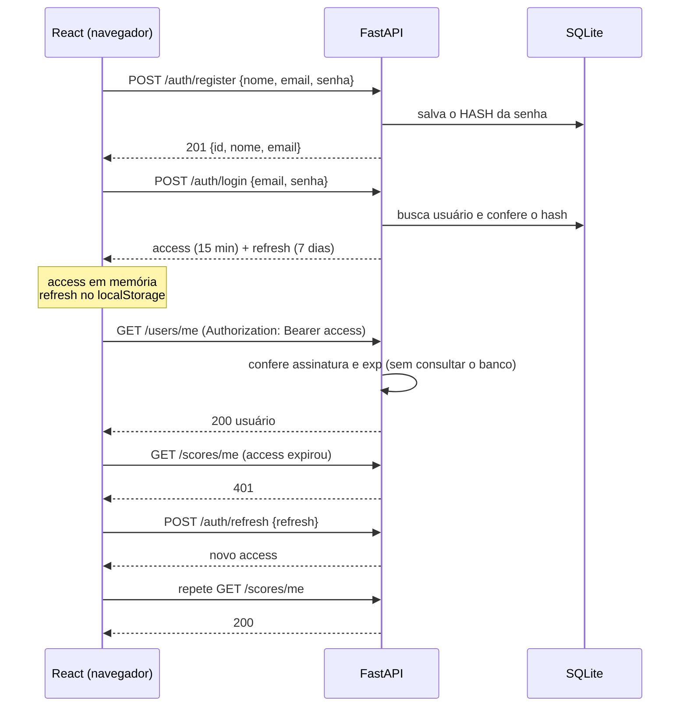

# 🎮 Rebote · API Cadastro

**🌐 No ar:** https://rebote-six.vercel.app (cadastro só com código de convite)

Projeto full stack de estudo com foco em **autenticação JWT**: a pessoa se **cadastra**, faz **login** e cai num **mini jogo de bolinha (Breakout)** cuja pontuação vai para um **ranking** no banco.

  

| Camada | Tecnologia |
|---|---|
| API | Python 3.12 · FastAPI · SQLAlchemy · SQLite |
| Autenticação | JWT (PyJWT) com access + refresh · hash de senha argon2 (pwdlib) |
| Front | React 19 · Vite · Tailwind CSS 4 · React Router · Axios |
| Jogo | Canvas puro + `requestAnimationFrame` (sem biblioteca de jogo) |
| Testes | pytest (84) · Vitest (26, motor do jogo) |

## O que tem

- **Cadastro e login** com validação, barra de força da senha, mostrar/ocultar senha, estados de carregamento e erro.
- **JWT**: access de 15 min + refresh de 7 dias; o front **renova sozinho** o token quando recebe 401.
- **Rotas protegidas** no back (`get_current_user`) e no front (`ProtectedRoute`).
- **Mini jogo Breakout**: vidas, níveis, bola que acelera, partículas e rastro, pausa, mouse/teclado/toque.
- **Ranking** top 10 (melhor resultado de cada jogador) e recorde pessoal, ligados ao usuário do token.
- **Segurança**: rate limit no login, CORS mínimo, erros genéricos, chave fraca barrada em produção. Veja [docs/seguranca.md](docs/seguranca.md).

## Fluxo JWT



## Como rodar

Pré-requisitos: Python 3.12+ e Node 22+.

### 1. Backend
```powershell
cd backend
python -m venv .venv
.venv\Scripts\Activate.ps1
pip install -r requirements.txt
copy .env.example .env        # depois troque a SECRET_KEY (comando de geração está dentro do arquivo)
uvicorn app.main:app --reload
```
API em http://localhost:8000 · documentação interativa em http://localhost:8000/docs

### 2. Frontend
```powershell
cd frontend
npm install
copy .env.example .env
npm run dev
```
App em http://localhost:5173. A rota `/status` mostra se o backend está online.

### 3. Testes
```powershell
# backend
cd backend
.venv\Scripts\Activate.ps1
pytest

# frontend (motor do jogo)
cd ..\frontend
npm test
```

## Deploy

| Peça | Onde | Observação |
|---|---|---|
| Site (React) | Vercel | `https://rebote-six.vercel.app`, pasta `frontend` |
| API (FastAPI) | Render (grátis) | `https://rebote-api.onrender.com`, descrita em `render.yaml` |
| Banco | Neon (Postgres grátis) | local continua em SQLite |

Variáveis da API (no painel do Render, nunca no GitHub): `DATABASE_URL`, `SECRET_KEY` (gerada pelo Render), `INVITE_CODE`, `MAX_USERS=5`, `FRONTEND_ORIGIN`, `ENVIRONMENT=production`. Variáveis do site (Vercel): `VITE_API_URL`, `VITE_EXIGE_CONVITE=true`. Passo a passo em [docs/etapas/etapa-12-deploy-no-ar.md](docs/etapas/etapa-12-deploy-no-ar.md).

## Estrutura

```
api_cadastro/
├── README.md                ← você está aqui
├── PLANO.md                 ← etapas e checklist (fonte da verdade)
├── docs/
│   ├── arquitetura.md       ← camadas, pastas e fluxo de sessão
│   ├── decisoes.md          ← por que cada tecnologia (23 decisões)
│   ├── api.md               ← contrato dos endpoints
│   ├── seguranca.md         ← revisão de segurança e riscos que restam
│   └── etapas/              ← um .md por etapa: passo a passo e como foi feito
├── backend/
│   ├── app/
│   │   ├── main.py          ← cria o app, CORS, registra routers
│   │   ├── core/            ← config.py, security.py (hash e JWT), rate_limit.py
│   │   ├── schemas.py       ← contrato de entrada/saída (Pydantic)
│   │   ├── database.py      ← engine, sessão e Base
│   │   ├── models.py        ← tabelas (User, Score)
│   │   ├── deps.py          ← get_db e get_current_user (a "catraca" do JWT)
│   │   └── routers/         ← health, auth, users, scores
│   ├── tests/               ← 84 testes
│   ├── requirements.txt
│   └── .env.example
└── frontend/
    └── src/
        ├── api/             ← client.js (Axios + interceptors), auth.js, scores.js, errors.js
        ├── auth/            ← tokenStore, AuthContext, useAuth, ProtectedRoute/GuestRoute
        ├── components/      ← Input, PasswordInput, Button, Card, Game, Ranking...
        ├── game/            ← engine.js (regras, testada) e render.js (canvas)
        ├── lib/             ← cn, validators, useForm
        ├── pages/           ← Login, Cadastro, Jogo, Status, NotFound
        └── index.css        ← tokens de design (cores, fonte)
```

## Documentação

| Quero... | Leia |
|---|---|
| colocar no ar (deploy) | [PLANO-DEPLOY.md](PLANO-DEPLOY.md) |
| rodar o projeto passo a passo | [docs/como-rodar.md](docs/como-rodar.md) |
| entender as camadas e o fluxo | [docs/arquitetura.md](docs/arquitetura.md) |
| saber por que escolhi cada coisa | [docs/decisoes.md](docs/decisoes.md) |
| ver os endpoints | [docs/api.md](docs/api.md) ou `/docs` com a API rodando |
| ver o que está protegido e o que falta | [docs/seguranca.md](docs/seguranca.md) |
| ver como cada etapa foi feita | [docs/etapas/](docs/etapas/) |

## Limites conhecidos (e próximos passos)

- Refresh token em `localStorage` (risco de XSS) e sem revogação no servidor → cookie `httpOnly` + rotação.
- A pontuação vem do navegador, então pode ser forjada → validar a partida no servidor.
- Rate limit em memória e só no login → Redis e limite em outras rotas.
- SQLite + `create_all` → Postgres + Alembic.
- Sem recuperação de senha nem confirmação de e-mail.
- Render grátis dorme após 15 min sem uso: o primeiro acesso demora cerca de 1 minuto. Sem Docker ainda.
